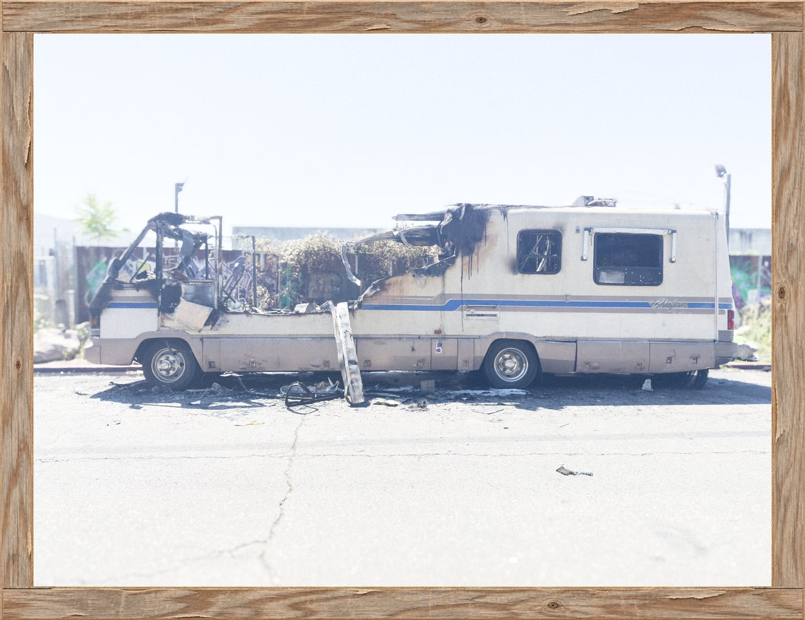

# Homepage photograph in old plywood

The main website asset is `../../TLM1-front-framed-plywood.jpg`, a 1920 × 1480 progressive JPEG at quality 84. It is approximately 349 KB, compared with the original 31.6 MB PNG. JPEG was selected after visually comparing the compressed photograph with the lossless working composite: it retains fine photographic grain better than the slightly smaller WebP at the chosen settings.

The original `../../TLM1-front.png` is unchanged. The full photograph is proportionally reduced to 1760 × 1320 and placed inside an 80-pixel frame. The frame adds 9.1% to the original photograph's width and 12.1% to its height, approximately 10% combined border in each dimension, with equal thickness on all four sides.

## Files

- `../../TLM1-front-framed-plywood.jpg`: 1920 × 1480, about 349 KB.
- `../../TLM1-front-framed-plywood-1280.jpg`: 1280 × 987, about 157 KB.
- `../../TLM1-front-framed-plywood-768.jpg`: 768 × 592, about 57 KB.
- Matching `.webp` versions: about 317 KB, 126 KB, and 45 KB respectively. These are optional alternatives.
- `../../TLM1-front-framed-plywood.json`: exact dimensions, sizes, source checksum, and framing geometry.
- `frame-generated.png`: the selected frame component, generated with the built-in imagegen tool. Its empty aperture is transparent.
- `generation-prompt.txt`: the complete imagegen prompt.
- `build.cjs`: reproducible assembly and export script using Sharp.

All final web images are opaque. No parts of the photograph are AI generated: imagegen supplied only the weathered-plywood component, which is mechanically resized and assembled around the original photograph. The four boards are unpainted old weathered plywood with plain square joints and no additional materials. Source photograph pixels are checked against the inset of the lossless composite before JPEG/WebP encoding.

## Website use

Use the JPEG `srcset` to let the browser choose a suitable download. Adjust `sizes` to match the actual page layout; this example assumes a maximum image width of 1280 CSS pixels. Keep width and height attributes so the browser reserves space before the image loads.

```html

```

## Rebuild

Run `npm install`, then `npm run build` in this directory. It uses the existing source PNG two directories above and writes the six compressed images and JSON metadata beside it. The optional arguments are `node build.cjs [source-photo] [output-directory]`.

Set `FRAME_PROOF_PATH` to an explicit local filename if a lossless working proof is needed. This large temporary PNG is not required for the website. The build checks the input aspect ratio, preserves the photograph before compression, verifies export dimensions and opacity, and confirms the source checksum is unchanged.

This is a separate plywood variation. The previous particle-board images and the original photograph are preserved. The built-in imagegen tool edited only the frame material, using `../TLM1-front-framed/frame-generated.png` as its reference. The plywood frame has worn veneer, subdued gray-brown grain, and exposed laminations.
